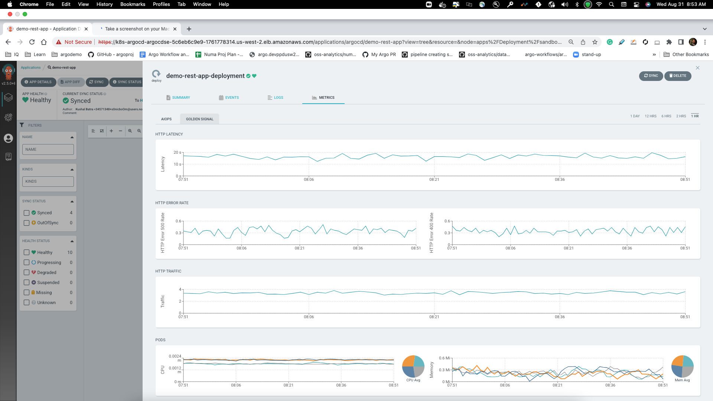

# ArgoCD Extension Metrics

The project introduces the ArgoCD extension to enable Metrics on Resource tab.


This extension is composed by 2 components:
- `argocd-metrics-server` is a backend service that queries and expose
  prometheus metrics to the UI extension
- UI extension render graphs based on metrics returned by the `argocd-metrics-server`

## Prerequisites

- Argo CD version 2.6+
- Prometheus

## Quick Start

### Install `argocd-metrics-server`

The `manifests` folder in this repo contains an example of how the
`argocd-metrics-server` can be installed.

```sh
git clone https://github.com/argoproj-labs/argocd-extension-metrics.git
cd argocd-extension-metrics
kustomize build ./manifests | kubectl apply -f -
```

All graphs are configured in the `argocd-metrics-server-configmap`.
The example configmap provided in the `manifests` defines how to
extract and query Prometheus to display the golden signal metrics in
Argo CD UI. Replace those queries with ones that match the metrics in
your Prometheus. See [Configuration](#configuration).


### Install UI extension

The UI extension needs to be installed by mounting the React component
in Argo CD API server. This process can be automated by using the
[argocd-extension-installer][1]. This installation method will run an
init container that will download, extract and place the file in the
correct location.

The yaml file below is an example of how to define a kustomize patch
to install this UI extension:

```yaml
apiVersion: apps/v1
kind: Deployment
metadata:
  name: argocd-server
spec:
  template:
    spec:
      initContainers:
        - name: extension-metrics
          image: quay.io/argoprojlabs/argocd-extension-installer:v0.0.1
          env:
          - name: EXTENSION_URL
            value: https://github.com/argoproj-labs/argocd-extension-metrics/releases/download/v1.0.0/extension.tar.gz
          - name: EXTENSION_CHECKSUM_URL
            value: https://github.com/argoproj-labs/argocd-extension-metrics/releases/download/v1.0.0/extension_checksums.txt
          volumeMounts:
            - name: extensions
              mountPath: /tmp/extensions/
          securityContext:
            runAsUser: 1000
            allowPrivilegeEscalation: false
      containers:
        - name: argocd-server
          volumeMounts:
            - name: extensions
              mountPath: /tmp/extensions/
      volumes:
        - name: extensions
          emptyDir: {}
```

### Enabling the Metrics extension in Argo CD

Argo CD needs to have the proxy extension feature enabled for the
metrics extension to work. In order to do so add the following entry
in the `argocd-cmd-params-cm`:

```yaml
server.enable.proxy.extension: "true"
```

The metrics extension needs to be authorized in Argo CD API server. To
enable it for all users add the following entry in `argocd-rbac-cm`:

```yaml
policy.csv: |-
  p, role:readonly, extensions, invoke, metrics, allow
```

> [!IMPORTANT]
> Make sure to assign a proper role to the extension policy if you
> want to restrict users.

Finally Argo CD needs to be configured so it knows how to reach the
metrics server. In order to do so, add the following section in the
`argocd-cm`.

```yaml
extension.config: |-
  extensions:
    - name: metrics
      backend:
        services:
          - url: <METRICS_SERVER_URL>
```

> [!NOTE]
> Make sure to change the `METRICS_SERVER_URL` to the URL
> where argocd-metrics-server is configured. The metrics server URL
> needs to be reacheable by the Argo CD API server.

## Configuration

After install, edit the `config.json` key of the `argocd-metrics-server-configmap` ConfigMap. A graph shows "Metric unavailable" when its query does not match anything in Prometheus.

```json
{
  "prometheus": {
    "applications": [
      {
        "name": "default",
        "default": true,
        "dashboards": [
          {
            "groupKind": "pod",
            "tabs": ["Golden Signal"],
            "rows": [
              {
                "name": "cpu",
                "title": "CPU",
                "tab": "Golden Signal",
                "graphs": [
                  {
                    "name": "pod_cpu",
                    "title": "CPU",
                    "graphType": "line",
                    "metricName": "pod",
                    "queryExpression": "sum(rate(container_cpu_usage_seconds_total{pod=~\"{{.name}}\"}[5m])) by (pod)"
                  }
                ]
              }
            ]
          }
        ]
      }
    ],
    "provider": {
      "name": "default",
      "default": true,
      "address": "http://prometheus-operated.monitoring.svc.cluster.local:9090"
    }
  }
}
```

- `applications[].name` is an Argo CD application name. The entry with `"default": true` is used for every application that does not have its own entry.
- `groupKind` selects the resource page. Use `pod`, `deployment`, or `rollout`. Those are the only kinds the UI extension registers, and the value must be lowercase.
- `tabs` lists the tab names. Each row's `tab` must be one of them.
- `graphType` is `line`, `pie`, or `anomaly`.
- `metricName` is the Prometheus label used as the graph legend. Set it to the label in the query's `by (...)`.
- `queryExpression` is PromQL. `{{.name}}`, `{{.namespace}}`, `{{.application_name}}`, `{{.project}}`, and `{{.duration}}` are filled in from the resource being viewed. `{{.name}}` is the resource name plus `.*`.
- `provider.address` is the Prometheus URL reachable from the metrics server.

The server reads `config.json` once at startup. The install manifest also mounts that file with `subPath`, so Kubernetes will not refresh it in a running container. After editing the ConfigMap, roll the server:

```sh
kubectl rollout restart deployment/argocd-metrics-server
```

## Contributing

TODO

[1]: https://github.com/argoproj-labs/argocd-extension-installer
